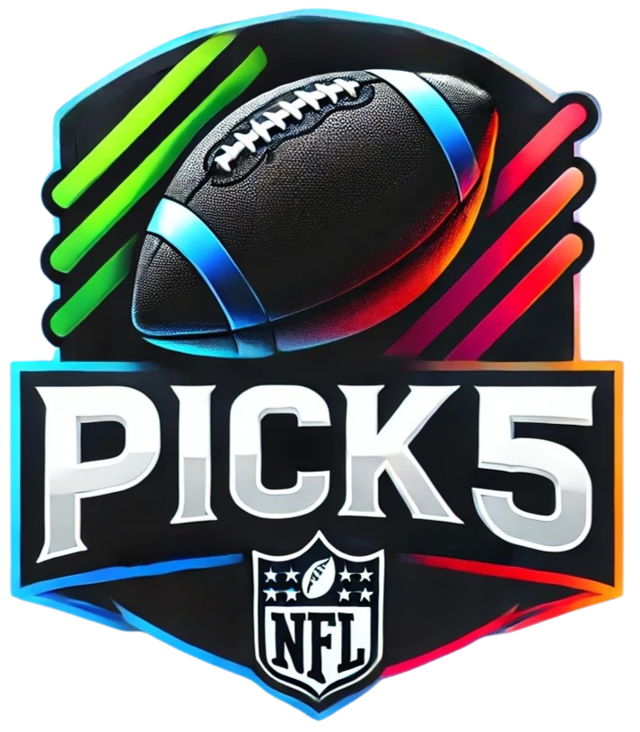
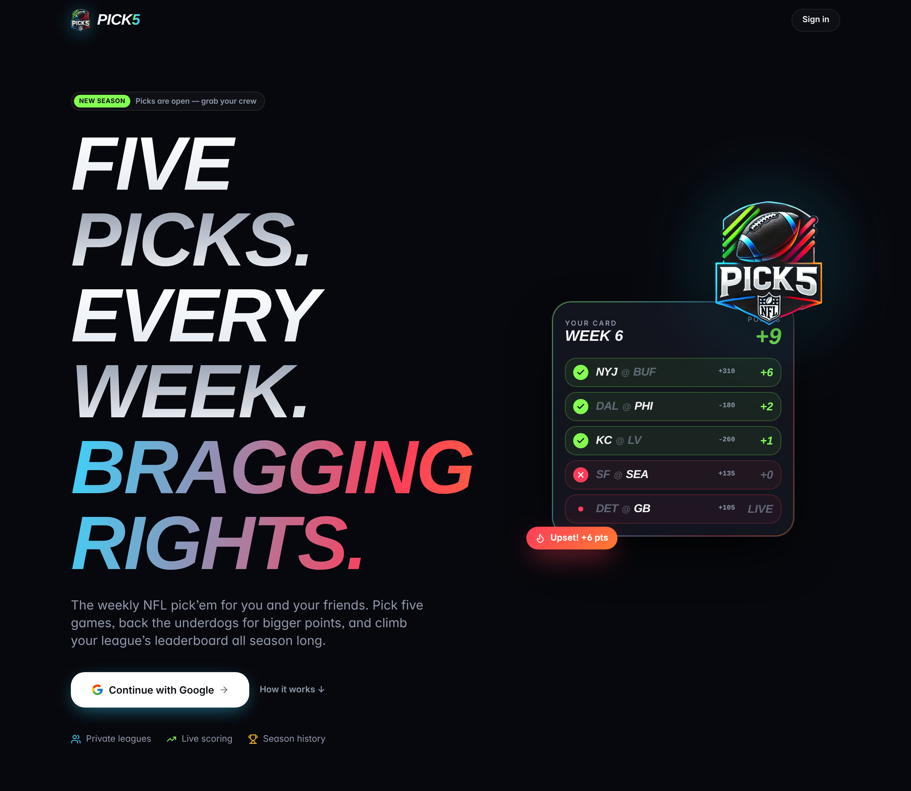
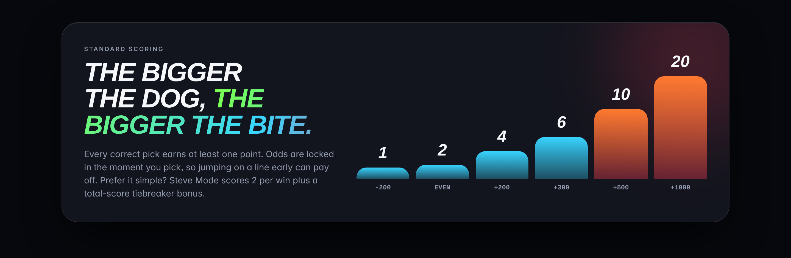
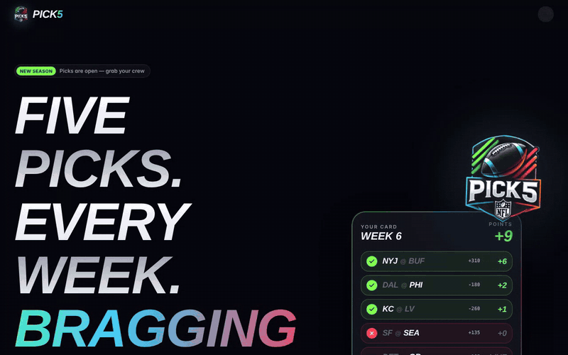
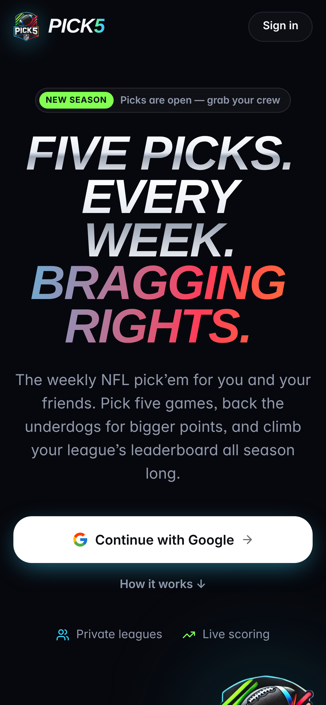
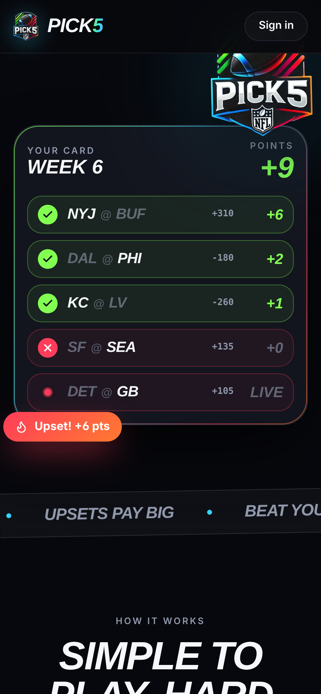

<p align="center">
  
</p>

<h1 align="center">Pick5</h1>

<p align="center">
  <b>Five picks. Every week. Bragging rights.</b><br/>
  A free NFL pick'em where calling the upset actually pays.
</p>

<p align="center">
  
</p>

## How it works

1. **Pick five games** every week. One of them can be your **Lock**, which counts double.
2. **Back the underdogs.** Your odds lock in the moment you pick, and points scale with the moneyline: a heavy favorite is worth 1 point, a +1000 long shot is worth 20.
3. **Climb the board** in private leagues with your friends, or on the global leaderboard.

<p align="center">
  
</p>

<p align="center">
  
</p>

## Features

- 🏈 **Odds-based scoring** with locked-in moneylines, plus a double-points Lock pick
- 👥 **Private leagues** you join with an invite link, with live scoring, matchups, an activity feed and season history
- 🧮 **League rule sets**: standard odds scoring, "Steve Mode" (2 points per win with a total-score tiebreaker) or a survivor view
- 🏅 **Stats and badges** for every player, and a global leaderboard
- 🔔 **Web push notifications** for kickoffs, pick reminders and weekly recaps
- 📬 **Reminder and recap emails** (Thursday and Saturday reminders, score emails, and nudges your leaguemates can send you), with one-click unsubscribe
- 🛠️ **Admin tools** for fixing odds, merging users and entering picks manually

<p align="center">
  
  &nbsp;&nbsp;
  
</p>

## Stack

| | |
|---|---|
| App | Next.js 15 (App Router), React, TypeScript, Tailwind, Radix UI |
| Data | MongoDB with Mongoose |
| Auth | NextAuth with Google sign-in |
| Odds | The Odds API, pulled on a schedule |
| Notifications | Web Push (VAPID), Resend + React Email |
| Hosting | Vercel, with a Cloudflare Workers path via OpenNext ([DEPLOY-CLOUDFLARE.md](DEPLOY-CLOUDFLARE.md)) |

## Run it locally

```bash
npm install
npm run dev
```

You'll need a `.env.local` with at least `MONGODB_URI`, `NEXTAUTH_SECRET`, `NEXTAUTH_URL`, `GOOGLE_ID`, `GOOGLE_SECRET` and `ODDS_API_KEY`. Push notifications also need `VAPID_PUBLIC_KEY` / `VAPID_PRIVATE_KEY`, and email needs `RESEND_API_KEY`.

<p align="center"><sub>Built by <a href="https://github.com/robwizzie">@robwizzie</a> for a group chat that takes football way too seriously.</sub></p>
